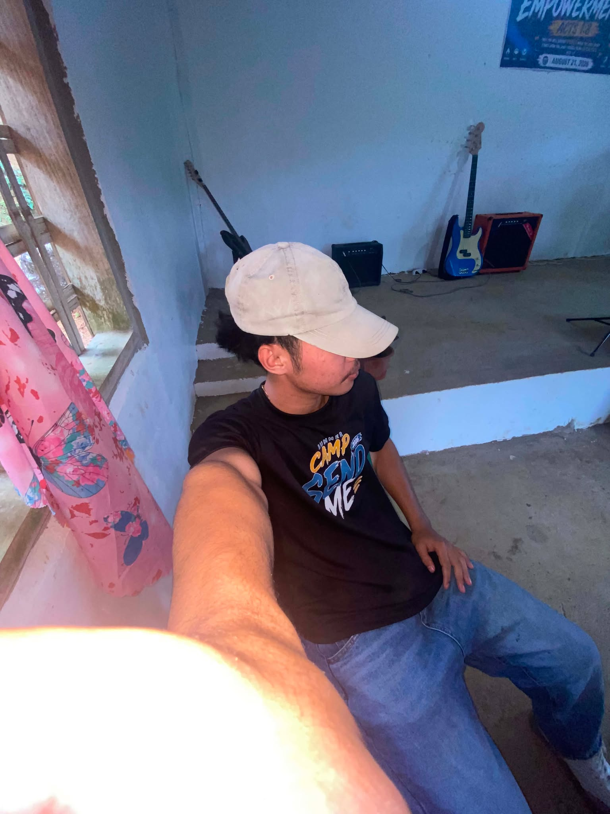

# kakamPINK

A simple, responsive pink-and-white group profile website made with HTML and CSS. Open `index.html` in a browser to use it. The homepage contains only the group introduction and five clickable member names; each name opens that member's profile page.

## Files

- `index.html` — group homepage
- `beamae.html` — Beamae A. Ejercito's profile
- `beajean.html` — Bea Jean A. Bacaoco's profile
- `michelle.html` — Michelle L. Detuya's profile
- `jino.html` — Jino P. Martinez's profile
- `joviel.html` — Joviel P. Landiza's profile

The profile pages use the existing repository photos: `profile.jpg`, `bea jean.jpg`, `MICHELL.jpg`, `jino (2).jpg`, and `JOVIEL.jpg`. Personal details that were not provided are marked as not provided rather than invented.

## Complete HTML source

### `index.html`

```html
<!DOCTYPE html>
<html lang="en">
<head>
  <meta charset="UTF-8">
  <meta name="viewport" content="width=device-width, initial-scale=1">
  <meta name="description" content="Meet the five BSIT students of kakamPINK.">
  <title>Welcome to kakamPINK!</title>
  <style>
    :root { color-scheme: light; --pink: #e94b91; --pink-pale: #fff0f6; --ink: #3d2935; }
    * { box-sizing: border-box; }
    body { min-height: 100vh; margin: 0; padding: 24px; display: grid; place-items: center; font-family: Arial, Helvetica, sans-serif; color: var(--ink); background: linear-gradient(145deg, #fff7fb, #ffe5f0); }
    main { width: min(100%, 680px); padding: clamp(28px, 7vw, 56px); background: #fff; border: 1px solid #f8d5e5; border-radius: 24px; box-shadow: 0 18px 50px #7f315219; }
    h1 { margin: 0 0 16px; color: var(--pink); font-size: clamp(2rem, 8vw, 3.2rem); line-height: 1.1; }
    .intro { margin: 0 0 28px; font-size: 1.08rem; line-height: 1.7; }
    ol { margin: 0; padding-left: 1.5rem; }
    li { padding: 9px 0; }
    li::marker { color: var(--pink); font-weight: 700; }
    a { color: #a52e67; font-size: 1.05rem; font-weight: 700; text-decoration-thickness: 2px; text-underline-offset: 4px; }
    a:hover, a:focus-visible { color: #6d1d46; }
    a:focus-visible { outline: 3px solid #f4a8c9; outline-offset: 4px; border-radius: 3px; }
  </style>
</head>
<body>
  <main>
    <h1>Welcome to kakamPINK!</h1>
    <p class="intro">Welcome to kakamPINK! We are five BSIT students from Negros Oriental State University. This website introduces our group and our individual profiles.</p>
    <ol>
      <li><a href="beamae.html">Beamae A. Ejercito</a></li>
      <li><a href="beajean.html">Bea Jean A. Bacaoco</a></li>
      <li><a href="michelle.html">Michelle L. Detuya</a></li>
      <li><a href="jino.html">Jino P. Martinez</a></li>
      <li><a href="joviel.html">Joviel P. Landiza</a></li>
    </ol>
  </main>
</body>
</html>
```

### `beamae.html`

```html
<!DOCTYPE html>
<html lang="en">
<head>
  <meta charset="UTF-8">
  <meta name="viewport" content="width=device-width, initial-scale=1">
  <meta name="description" content="Beamae A. Ejercito's kakamPINK profile.">
  <title>Beamae A. Ejercito | kakamPINK</title>
  <style>
    :root { --pink: #e94b91; --pale: #fff0f6; --ink: #3d2935; --muted: #715e69; }
    * { box-sizing: border-box; }
    body { min-height: 100vh; margin: 0; padding: 24px; font-family: Arial, Helvetica, sans-serif; color: var(--ink); background: linear-gradient(145deg, #fff7fb, #ffe5f0); }
    main { width: min(100%, 760px); margin: 0 auto; padding: clamp(24px, 6vw, 48px); background: #fff; border: 1px solid #f8d5e5; border-radius: 24px; box-shadow: 0 18px 50px #7f315219; }
    .back { display: inline-block; margin-bottom: 24px; color: #a52e67; font-weight: 700; text-underline-offset: 4px; }
    .back:focus-visible, a:focus-visible { outline: 3px solid #f4a8c9; outline-offset: 4px; }
    .profile { display: grid; grid-template-columns: minmax(120px, 190px) 1fr; gap: 28px; align-items: center; }
    .profile img { display: block; width: 100%; aspect-ratio: 1; object-fit: cover; border: 6px solid var(--pale); border-radius: 50%; }
    h1 { margin: 0 0 10px; color: var(--pink); font-size: clamp(1.8rem, 6vw, 2.7rem); line-height: 1.15; }
    .intro { color: var(--muted); line-height: 1.65; }
    h2 { margin: 28px 0 8px; color: #a52e67; font-size: 1.15rem; }
    p, ul { line-height: 1.65; }
    ul { margin: 0; padding-left: 1.35rem; }
    .unknown { color: var(--muted); }
    @media (max-width: 520px) { body { padding: 14px; } .profile { grid-template-columns: 1fr; gap: 18px; } .profile img { width: min(58vw, 190px); } }
  </style>
</head>
<body>
  <main>
    <a class="back" href="index.html">← Back to kakamPINK</a>
    <section class="profile" aria-labelledby="name">
      
      <div>
        <h1 id="name">Beamae A. Ejercito</h1>
        <p class="intro">Introduction: <span class="unknown">Not provided yet.</span></p>
      </div>
    </section>
    <section aria-label="Profile details">
      <h2>Personal information</h2><p class="unknown">Not provided yet.</p>
      <h2>Hobbies</h2><p class="unknown">Not provided yet.</p>
      <h2>Top three favorite foods</h2><ul><li class="unknown">Not provided yet.</li></ul>
      <h2>Favorite website</h2><p class="unknown">Not provided yet.</p>
    </section>
  </main>
</body>
</html>
```

### `beajean.html`

```html
<!DOCTYPE html>
<html lang="en">
<head>
  <meta charset="UTF-8">
  <meta name="viewport" content="width=device-width, initial-scale=1">
  <meta name="description" content="Bea Jean A. Bacaoco's kakamPINK profile.">
  <title>Bea Jean A. Bacaoco | kakamPINK</title>
  <style>
    :root { --pink: #e94b91; --pale: #fff0f6; --ink: #3d2935; --muted: #715e69; }
    * { box-sizing: border-box; }
    body { min-height: 100vh; margin: 0; padding: 24px; font-family: Arial, Helvetica, sans-serif; color: var(--ink); background: linear-gradient(145deg, #fff7fb, #ffe5f0); }
    main { width: min(100%, 760px); margin: 0 auto; padding: clamp(24px, 6vw, 48px); background: #fff; border: 1px solid #f8d5e5; border-radius: 24px; box-shadow: 0 18px 50px #7f315219; }
    .back { display: inline-block; margin-bottom: 24px; color: #a52e67; font-weight: 700; text-underline-offset: 4px; }
    .back:focus-visible, a:focus-visible { outline: 3px solid #f4a8c9; outline-offset: 4px; }
    .profile { display: grid; grid-template-columns: minmax(120px, 190px) 1fr; gap: 28px; align-items: center; }
    .profile img { display: block; width: 100%; aspect-ratio: 1; object-fit: cover; border: 6px solid var(--pale); border-radius: 50%; }
    h1 { margin: 0 0 10px; color: var(--pink); font-size: clamp(1.8rem, 6vw, 2.7rem); line-height: 1.15; }
    .intro { color: var(--muted); line-height: 1.65; }
    h2 { margin: 28px 0 8px; color: #a52e67; font-size: 1.15rem; }
    p, ul { line-height: 1.65; }
    ul { margin: 0; padding-left: 1.35rem; }
    .unknown { color: var(--muted); }
    @media (max-width: 520px) { body { padding: 14px; } .profile { grid-template-columns: 1fr; gap: 18px; } .profile img { width: min(58vw, 190px); } }
  </style>
</head>
<body>
  <main>
    <a class="back" href="index.html">← Back to kakamPINK</a>
    <section class="profile" aria-labelledby="name">
      
      <div>
        <h1 id="name">Bea Jean A. Bacaoco</h1>
        <p class="intro">Introduction: <span class="unknown">Not provided yet.</span></p>
      </div>
    </section>
    <section aria-label="Profile details">
      <h2>Personal information</h2><p class="unknown">Not provided yet.</p>
      <h2>Hobbies</h2><p class="unknown">Not provided yet.</p>
      <h2>Top three favorite foods</h2><ul><li class="unknown">Not provided yet.</li></ul>
      <h2>Favorite website</h2><p class="unknown">Not provided yet.</p>
    </section>
  </main>
</body>
</html>
```

### `michelle.html`

```html
<!DOCTYPE html>
<html lang="en">
<head>
  <meta charset="UTF-8">
  <meta name="viewport" content="width=device-width, initial-scale=1">
  <meta name="description" content="Michelle L. Detuya's kakamPINK profile.">
  <title>Michelle L. Detuya | kakamPINK</title>
  <style>
    :root { --pink: #e94b91; --pale: #fff0f6; --ink: #3d2935; --muted: #715e69; }
    * { box-sizing: border-box; }
    body { min-height: 100vh; margin: 0; padding: 24px; font-family: Arial, Helvetica, sans-serif; color: var(--ink); background: linear-gradient(145deg, #fff7fb, #ffe5f0); }
    main { width: min(100%, 760px); margin: 0 auto; padding: clamp(24px, 6vw, 48px); background: #fff; border: 1px solid #f8d5e5; border-radius: 24px; box-shadow: 0 18px 50px #7f315219; }
    .back { display: inline-block; margin-bottom: 24px; color: #a52e67; font-weight: 700; text-underline-offset: 4px; }
    .back:focus-visible, a:focus-visible { outline: 3px solid #f4a8c9; outline-offset: 4px; }
    .profile { display: grid; grid-template-columns: minmax(120px, 190px) 1fr; gap: 28px; align-items: center; }
    .profile img { display: block; width: 100%; aspect-ratio: 1; object-fit: cover; border: 6px solid var(--pale); border-radius: 50%; }
    h1 { margin: 0 0 10px; color: var(--pink); font-size: clamp(1.8rem, 6vw, 2.7rem); line-height: 1.15; }
    .intro { color: var(--muted); line-height: 1.65; }
    h2 { margin: 28px 0 8px; color: #a52e67; font-size: 1.15rem; }
    p, ul { line-height: 1.65; }
    ul { margin: 0; padding-left: 1.35rem; }
    .unknown { color: var(--muted); }
    @media (max-width: 520px) { body { padding: 14px; } .profile { grid-template-columns: 1fr; gap: 18px; } .profile img { width: min(58vw, 190px); } }
  </style>
</head>
<body>
  <main>
    <a class="back" href="index.html">← Back to kakamPINK</a>
    <section class="profile" aria-labelledby="name">
      
      <div>
        <h1 id="name">Michelle L. Detuya</h1>
        <p class="intro">Introduction: <span class="unknown">Not provided yet.</span></p>
      </div>
    </section>
    <section aria-label="Profile details">
      <h2>Personal information</h2><p class="unknown">Not provided yet.</p>
      <h2>Hobbies</h2><p class="unknown">Not provided yet.</p>
      <h2>Top three favorite foods</h2><ul><li class="unknown">Not provided yet.</li></ul>
      <h2>Favorite website</h2><p class="unknown">Not provided yet.</p>
    </section>
  </main>
</body>
</html>
```

### `jino.html`

```html
<!DOCTYPE html>
<html lang="en">
<head>
  <meta charset="UTF-8">
  <meta name="viewport" content="width=device-width, initial-scale=1">
  <meta name="description" content="Jino P. Martinez's kakamPINK profile.">
  <title>Jino P. Martinez | kakamPINK</title>
  <style>
    :root { --pink: #e94b91; --pale: #fff0f6; --ink: #3d2935; --muted: #715e69; }
    * { box-sizing: border-box; }
    body { min-height: 100vh; margin: 0; padding: 24px; font-family: Arial, Helvetica, sans-serif; color: var(--ink); background: linear-gradient(145deg, #fff7fb, #ffe5f0); }
    main { width: min(100%, 760px); margin: 0 auto; padding: clamp(24px, 6vw, 48px); background: #fff; border: 1px solid #f8d5e5; border-radius: 24px; box-shadow: 0 18px 50px #7f315219; }
    .back { display: inline-block; margin-bottom: 24px; color: #a52e67; font-weight: 700; text-underline-offset: 4px; }
    .back:focus-visible, a:focus-visible { outline: 3px solid #f4a8c9; outline-offset: 4px; }
    .profile { display: grid; grid-template-columns: minmax(120px, 190px) 1fr; gap: 28px; align-items: center; }
    .profile img { display: block; width: 100%; aspect-ratio: 1; object-fit: cover; border: 6px solid var(--pale); border-radius: 50%; }
    h1 { margin: 0 0 10px; color: var(--pink); font-size: clamp(1.8rem, 6vw, 2.7rem); line-height: 1.15; }
    .intro { color: var(--muted); line-height: 1.65; }
    h2 { margin: 28px 0 8px; color: #a52e67; font-size: 1.15rem; }
    p, ul { line-height: 1.65; }
    ul { margin: 0; padding-left: 1.35rem; }
    .unknown { color: var(--muted); }
    @media (max-width: 520px) { body { padding: 14px; } .profile { grid-template-columns: 1fr; gap: 18px; } .profile img { width: min(58vw, 190px); } }
  </style>
</head>
<body>
  <main>
    <a class="back" href="index.html">← Back to kakamPINK</a>
    <section class="profile" aria-labelledby="name">
      
      <div>
        <h1 id="name">Jino P. Martinez</h1>
        <p class="intro">Introduction: <span class="unknown">Not provided yet.</span></p>
      </div>
    </section>
    <section aria-label="Profile details">
      <h2>Personal information</h2><p class="unknown">Not provided yet.</p>
      <h2>Hobbies</h2><p class="unknown">Not provided yet.</p>
      <h2>Top three favorite foods</h2><ul><li class="unknown">Not provided yet.</li></ul>
      <h2>Favorite website</h2><p class="unknown">Not provided yet.</p>
    </section>
  </main>
</body>
</html>
```

### `joviel.html`

```html
<!DOCTYPE html>
<html lang="en">
<head>
  <meta charset="UTF-8">
  <meta name="viewport" content="width=device-width, initial-scale=1">
  <meta name="description" content="Joviel P. Landiza's kakamPINK profile.">
  <title>Joviel P. Landiza | kakamPINK</title>
  <style>
    :root { --pink: #e94b91; --pale: #fff0f6; --ink: #3d2935; --muted: #715e69; }
    * { box-sizing: border-box; }
    body { min-height: 100vh; margin: 0; padding: 24px; font-family: Arial, Helvetica, sans-serif; color: var(--ink); background: linear-gradient(145deg, #fff7fb, #ffe5f0); }
    main { width: min(100%, 760px); margin: 0 auto; padding: clamp(24px, 6vw, 48px); background: #fff; border: 1px solid #f8d5e5; border-radius: 24px; box-shadow: 0 18px 50px #7f315219; }
    .back { display: inline-block; margin-bottom: 24px; color: #a52e67; font-weight: 700; text-underline-offset: 4px; }
    .back:focus-visible, a:focus-visible { outline: 3px solid #f4a8c9; outline-offset: 4px; }
    .profile { display: grid; grid-template-columns: minmax(120px, 190px) 1fr; gap: 28px; align-items: center; }
    .profile img { display: block; width: 100%; aspect-ratio: 1; object-fit: cover; border: 6px solid var(--pale); border-radius: 50%; }
    h1 { margin: 0 0 10px; color: var(--pink); font-size: clamp(1.8rem, 6vw, 2.7rem); line-height: 1.15; }
    .intro { color: var(--muted); line-height: 1.65; }
    h2 { margin: 28px 0 8px; color: #a52e67; font-size: 1.15rem; }
    p, ul { line-height: 1.65; }
    ul { margin: 0; padding-left: 1.35rem; }
    .unknown { color: var(--muted); }
    @media (max-width: 520px) { body { padding: 14px; } .profile { grid-template-columns: 1fr; gap: 18px; } .profile img { width: min(58vw, 190px); } }
  </style>
</head>
<body>
  <main>
    <a class="back" href="index.html">← Back to kakamPINK</a>
    <section class="profile" aria-labelledby="name">
      
      <div>
        <h1 id="name">Joviel P. Landiza</h1>
        <p class="intro">Introduction: <span class="unknown">Not provided yet.</span></p>
      </div>
    </section>
    <section aria-label="Profile details">
      <h2>Personal information</h2><p class="unknown">Not provided yet.</p>
      <h2>Hobbies</h2><p class="unknown">Not provided yet.</p>
      <h2>Top three favorite foods</h2><ul><li class="unknown">Not provided yet.</li></ul>
      <h2>Favorite website</h2><p class="unknown">Not provided yet.</p>
    </section>
  </main>
</body>
</html>
```
